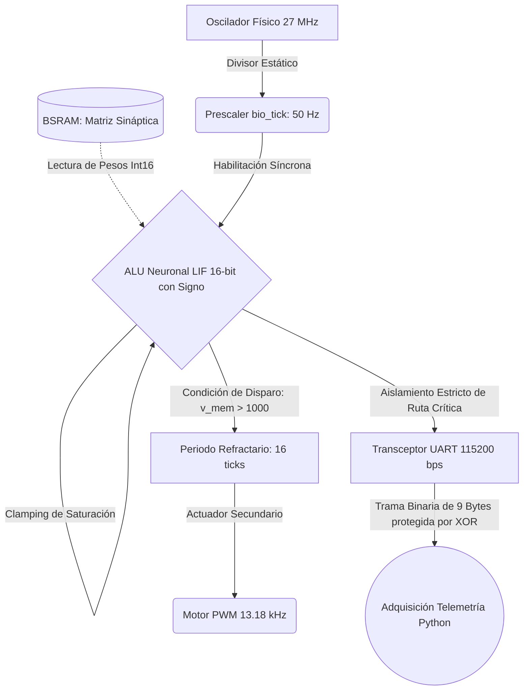

# Edge Neuromorphic LIF Accelerator on FPGA (Gowin GW1NR-9C)


## Resumen Ejecutivo
Implementación RTL de una arquitectura neuromórfica dirigida por eventos (Spiking Neural Network) evaluada sobre hardware FPGA. Resuelve la ineficiencia térmica y el cuello de botella de latencia propios de la arquitectura de Von Neumann mediante computación *in-memory* a nivel de compuerta. La ecuación diferencial biológica se discretiza en silicio mediante aritmética de saturación de punto fijo con signo de 16-bits, omitiendo el uso de bloques DSP y garantizando una correlación matemática exacta ($R=1.0000$) con modelos *golden* de neurociencia computacional.

---

## Arquitectura Interna del Silicio ("Inside the Black Box")

La interfaz visual (LEDs) opera exclusivamente como actuador esclavo PWM. El núcleo computacional es una máquina de estados finitos (FSM) síncrona gobernada por un *prescaler* a 50 Hz, que procesa tensores desde la memoria BSRAM y transmite el estado estricto del hardware a través de un bus UART dedicado.



---

## Inmersión Técnica Módulo por Módulo
* **`bram_synapse.v`:** Memoria de pesos sinápticos. Utiliza el pragma `(* ram_style = "block" *)` para forzar la síntesis en bloques BSRAM nativos, evitando el consumo ineficiente de lógica distribuida (LUTs).
* **`lif_neuron.v`:** Núcleo aritmético. Implementa un sumador extendido de 18 bits (`v_sum`) que previene el desbordamiento circular (*integer overflow*) mediante multiplexores de saturación simétrica, limitando el registro de membrana estrictamente entre el límite superior ($+32767$) y el límite de hiperpolarización biológica ($-250$).
* **`button_debouncer.v`:** Acondicionador físico de señal. Implementa sincronización de dos etapas (2-FF Synchronizer) contra metaestabilidad y temporizador de antirrebote mecánico de 20 ms, garantizando un estímulo biológico determinista e inmunidad total a ruidos de conmutación.
* **`uart_transceiver.v`:** Interfaz de adquisición. Serializa los registros lógicos de 16 bits sin introducir contrapresión (*back-pressure*) ni alterar los periodos de reloj de la ALU neuronal.

---

## Métricas Duras y Benchmarks de Silicio (GW1NR-9C)

| Métrica Paramétrica | Valor Extraído en Silicio | Implicación Arquitectónica |
| :--- | :---: | :--- |
| **LUTs (Lógica Combinacional)** | **833 / 8,640 (9.64%)** | Margen área-lógica habilitado para expansión de nodos de red |
| **Registros (Flip-Flops)** | **207 / 6,480 (3.19%)** | Carga capacitiva mínima en enrutamiento estático cruzado |
| **Memoria en Bloque (BSRAM)** | **1 / 26 Bloques (3.85%)** | Infraestructura disponible para plasticidad local (STDP) |
| **Temporizado Estático ($F_{clk}$)** | **27.0 MHz (Holgura: > 27 ns)** | Determinismo absoluto; 0 violaciones de Setup/Hold |
| **Validación Cruzada (RTL vs Python)** | **Pearson $R = 1.0000$, RMSE $= 0.0$** | Identidad bit a bit sobre 132 ciclos biológicos evaluados |

---

## Guía de Reproducción Determinista

Ejecución automatizada desatendida mediante toolchains de código abierto y CLI nativa:

```bash
# 1. Clonar repositorio e instalar dependencias del host
git clone https://github.com/usuario/tang-nano-lif.git
cd tang-nano-lif
pip install -r requirements.txt

# 2. Simulación RTL (Requiere OSS CAD Suite / Icarus Verilog)
# 2.1 Verificación unitaria del núcleo LIF
iverilog -g2012 -s tb_lif_neuron -o build/sim_unit.vvp src_verilog/hdl/lif_neuron.v src_verilog/tb/tb_lif_neuron.v
vvp build/sim_unit.vvp

# 2.2 Verificación de integración del sistema completo con debouncers
iverilog -g2012 -s tb_top_system -o build/sim_top.vvp src_verilog/hdl/button_debouncer.v src_verilog/bram_synapse_matrix.v src_verilog/hdl/lif_neuron.v src_verilog/hdl/uart_transceiver.v src_verilog/top_lif_demo.v src_verilog/tb/tb_top_system.v
vvp build/sim_top.vvp

# 3. Síntesis y P&R (Gowin CLI)
gw_sh.exe build.tcl

# 4. Programación en Flash Interna No Volátil
programmer_cli.exe --device GW1NR-9C --run 5 impl/pnr/project.fs

# 5. Adquisición de Telemetría (Python)
python telemetry/telemetry_listener.py --port COM4 --baud 115200
```

---

## Estructura Modular del Proyecto

```text
├── .gitignore                      # Reglas de exclusión para Gowin EDA y Python
├── README.md                       # Documentación maestra y abstract técnico (Capa 1)
├── requirements.txt                # Dependencias fijadas del host (pyserial, numpy, matplotlib)
├── LICENSE                         # Licencia de código abierto MIT (Kevin Mejía Cedeño)
├── build.tcl                       # Script de automatización TCL para síntesis y P&R en Gowin
├── LIF_Hardware.gprj               # Archivo de proyecto maestro de Gowin EDA
│
├── constraints/                    # Restricciones físicas y temporales
│   ├── tangnano9k.sdc              # Restricción de temporizado estático (27 MHz)
│   └── tangnano9k_pins.cst         # Asignación física de pines (Tang Nano 9K)
│
├── data/                           # Datos estáticos del hardware
│   └── pesos_sinapticos.hex        # Matriz de pesos cuantizados para memoria BRAM
│
├── src_verilog/                    # [Núcleo RTL y Testbenches]
│   ├── hdl/                        # Módulos de síntesis en silicio
│   │   ├── lif_neuron.v            # Núcleo aritmético LIF continuo con clamping (16-bit)
│   │   ├── bram_synapse.v          # Controlador de lectura de memoria BSRAM
│   │   ├── button_debouncer.v      # Acondicionador 2-FF y antirrebote mecánico (20 ms)
│   │   ├── uart_transceiver.v      # Transmisor serial síncrono a 115200 bps
│   │   └── top_lif_demo.v          # Integración de alto nivel, prescaler 50 Hz y PWM 13.2 kHz
│   └── tb/                         # Bancos de pruebas de verificación
│       ├── tb_lif_neuron.v         # Testbench de verificación funcional unitaria (132 ticks)
│       └── tb_top_system.v         # Testbench de integración a nivel de sistema con ruido
│
├── src_py/                         # [Modelo Matemático Golden]
│   ├── lif_math_model.py           # Modelo analítico Golden bit a bit (Verificación cruzada)
│   ├── lif_equivalence.py          # Emulador de equivalencia ciclo a ciclo en punto fijo (int16)
│   └── train_and_export.py         # Generador y cuantizador de pesos sinápticos BRAM
│
├── telemetry/                      # [Scripts de Adquisición UART e Inferencia]
│   └── telemetry_listener.py       # Receptor de tramas de 9 bytes a 115200 bps (GUI y Consola)
│
└── docs/                           # [Reportes de Ingeniería y Diagramas]
    ├── GROUND_TRUTH_AUDIT.md       # Auditoría forense y verdad base del silicio
    ├── TECHNICAL_REPORT.md         # Memoria de investigación y roadmap AER (Capa 2)
    ├── SPEAKER_GUIDE.md            # Guion de ponencia e instrucción operativa (Capa 3)
    ├── FICHA_TECNICA.md            # Hoja de datos técnicos de hardware y pinout físico
    ├── GUION_DEMO.md               # Guion cronometrado minuto a minuto
    ├── lif_validation_curve.png    # Curva de correlación temporal Golden vs RTL
    ├── lif_equivalence_plot.png    # Gráfica científica de 3 paneles (1000 pasos / 20 s)
    └── lif_equivalence_data.csv    # Dataset tabular generado por la emulación de 16 bits
```

---

## Licencia
Este proyecto está licenciado bajo los términos de la [Licencia MIT](LICENSE).
