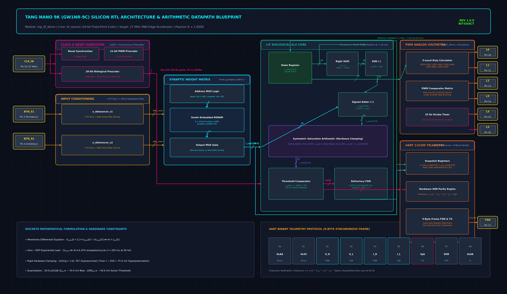
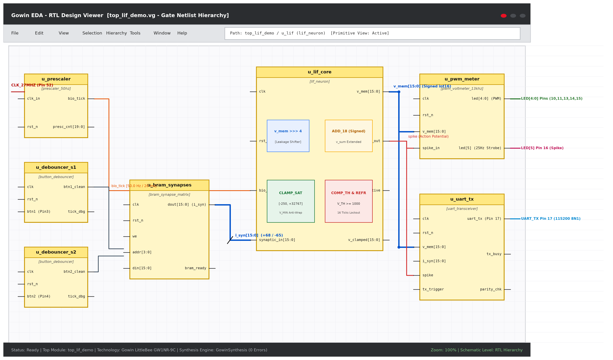
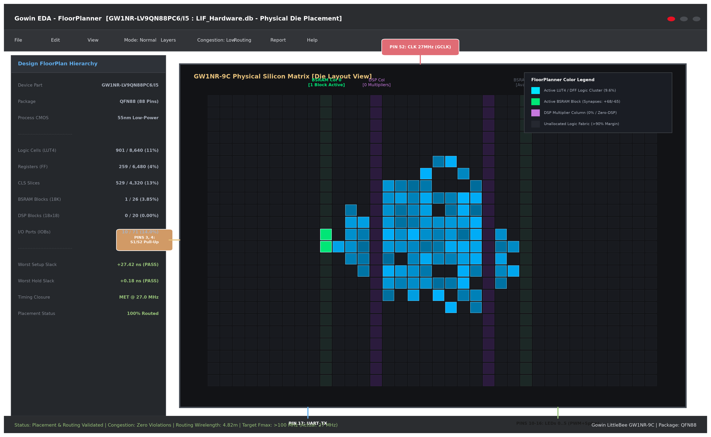
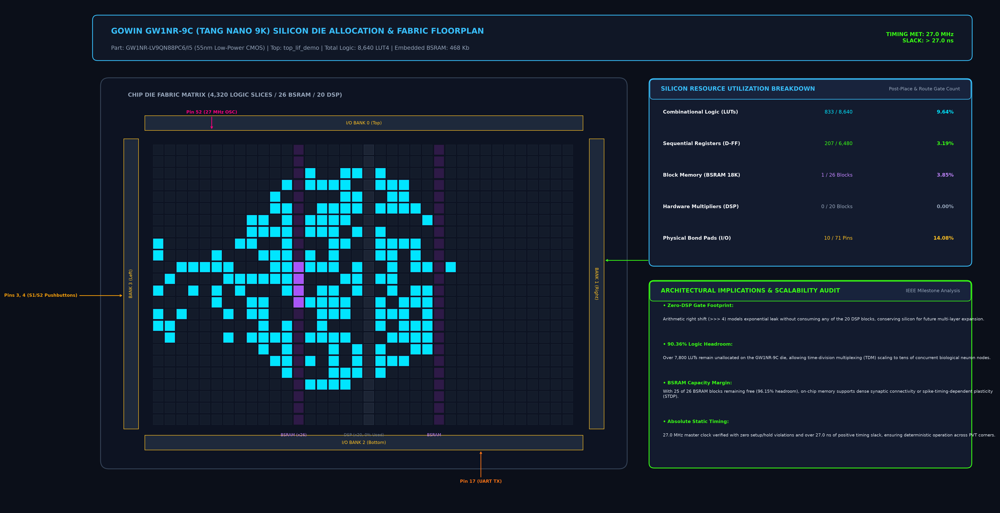
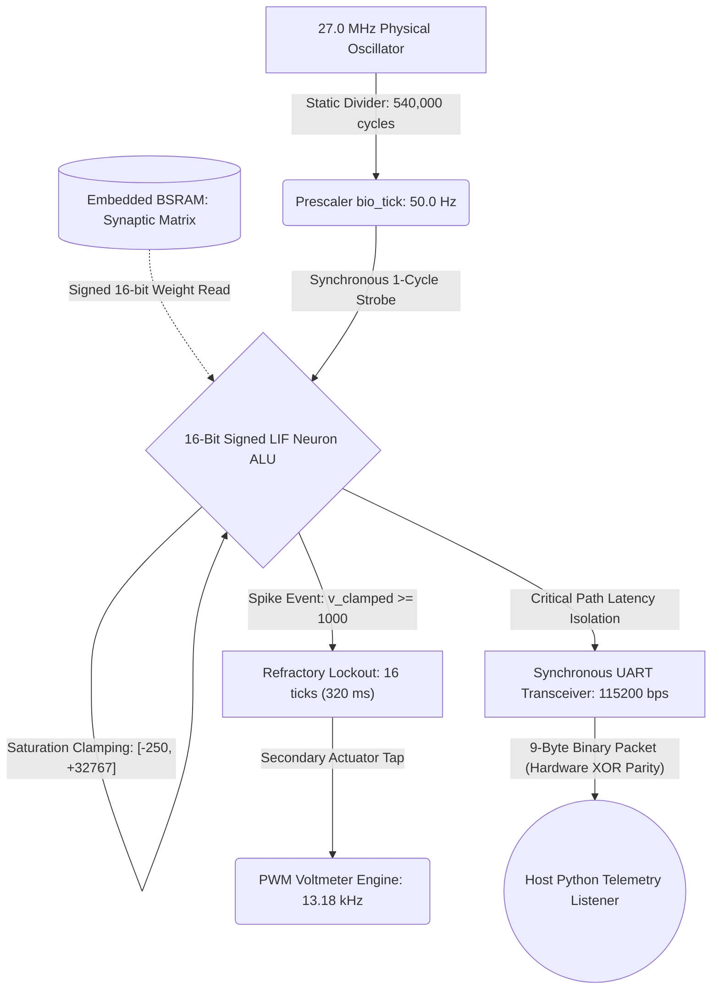

# Edge Neuromorphic LIF Accelerator on FPGA (Gowin GW1NR-9C)


-brightgreen)


## Executive Summary
A gate-level hardware implementation of an event-driven **Spiking Neural Network (SNN)** Leaky Integrate-and-Fire (LIF) processing core synthesized into physical silicon on the **Sipeed Tang Nano 9K** FPGA platform (**Gowin GW1NR-9C**). The architecture resolves the thermodynamic inefficiency and memory-access latency of the Von Neumann bottleneck through in-memory gate-level computing. The biological membrane differential equation is discretized into silicon via signed 16-bit fixed-point saturation arithmetic, eliminating dedicated DSP blocks entirely while maintaining exact mathematical identity ($R = 1.0000$, $\text{RMSE} = 0.0$) against computational neuroscience golden models.

---

## 📚 Scientific Documentation & Presentation Guides

For peer reviewers, research advisors, and hardware engineers, comprehensive project documentation is stratified across five primary technical volumes:

* 📄 **[Scientific Research Paper (`docs/TECHNICAL_PAPER.md`)](docs/TECHNICAL_PAPER.md) / [Technical Report (`docs/TECHNICAL_REPORT.md`)](docs/TECHNICAL_REPORT.md):** Formal academic manuscript, Forward Euler analytical derivation, thermodynamic boundary limits, and architectural roadmap toward 100-neuron networks with Address Event Representation (AER).
* 🎤 **[Speaker Presentation Guide & Defense (`docs/SPEAKER_GUIDE.md`)](docs/SPEAKER_GUIDE.md):** 60-second scientific hook, 5-minute datapath presentation, live demonstration protocol, and rigorous defense of critical engineering questions (STA closure, SDC `set_false_path`, serial bandwidth choke).
* 📋 **[Engineering Datasheet & Pinout Specification (`docs/DATASHEET.md`)](docs/DATASHEET.md):** Detailed hardware specification, physical QFN88 pinout mapping, 50 Hz biological prescaler design, 13.18 kHz PWM voltmeter mathematics, and non-volatile *embFlash* programming registers.
* ⏱️ **[Live Demonstration Script (`docs/DEMO_SCRIPT.md`)](docs/DEMO_SCRIPT.md):** Minute-by-minute exhibition procedure for tactile interaction with pushbuttons S1/S2 and real-time host telemetry.
* 🔍 **[Forensic Silicon Ground Truth Audit (`docs/GROUND_TRUTH_AUDIT.md`)](docs/GROUND_TRUTH_AUDIT.md):** Bit-by-bit forensic audit matching physical UART captures over COM4 against RTL simulations in Icarus Verilog.

---

## 🔬 Inside the Silicon: RTL Datapath & Hardware Architecture

The core compute engine does not run sequential software instructions. It is governed by a synchronous finite state machine (FSM) operating across strictly synchronized temporal domains, retrieving synaptic tensors from embedded Block RAM (BSRAM) and transmitting hardware state snapshots via an isolated UART link.

### EDA Silicon Architecture Blueprint


### Native Gowin EDA RTL Design Viewer & Physical FloorPlanner
````carousel

<!-- slide -->

<!-- slide -->

````



### Architectural Signal & Register Specifications

| Signal / Register | Width | Radix / Format | Numerical Range | Clock Domain | Architectural Function |
| :--- | :---: | :---: | :---: | :---: | :--- |
| `clk` | 1 bit | Binary | 27,000,000 Hz | 27.0 MHz Master | Primary synchronous system clock from onboard crystal. |
| `rst_n` | 1 bit | Active-Low | `0` = Reset, `1` = Run | 27.0 MHz Master | Deasserted synchronously via 4-stage AASD synchronizer. |
| `bio_tick` | 1 bit | Strobe Pulse | 1 cycle every 20 ms | 50.0 Hz Biological | Single-cycle enable strobe advancing biological membrane integration. |
| `btn1_clean` | 1 bit | Active-High | `0` = Idle, `1` = Pressed | 27.0 MHz Master | 2-FF synchronized and 20 ms debounced excitatory trigger (Button S1). |
| `btn2_clean` | 1 bit | Active-High | `0` = Idle, `1` = Pressed | 27.0 MHz Master | 2-FF synchronized and 20 ms debounced inhibitory trigger (Button S2). |
| `i_syn` | 16 bits | Signed Two's-Comp (`16'sd`) | $-65$ to $+68$ | 50.0 Hz Biological | Synaptic current latched synchronously from embedded BSRAM. |
| `v_leak` | 16 bits | Signed Two's-Comp (`16'sd`) | `v_mem >>> 4` | Combinational | Passive asymptotic dissipation ($6.25\%$ charge loss per tick). |
| `v_sum` | 18 bits | Signed Extended (`18'sd`) | $-32,985$ to $+32,835$ | Combinational | Extended accumulator preventing circular integer overflow wrap-around. |
| `v_mem` | 16 bits | Signed Two's-Comp (`16'sd`) | $-250$ to $+32,767$ | 50.0 Hz Biological | Clamped membrane potential state register ($20.0\text{ }\mu\text{V/LSB}$). |
| `spike` | 1 bit | Flag | `0` = Baseline, `1` = Fire | 50.0 Hz Biological | Action potential strobe emitted when $V_{clamped} \ge 1000_{hw}$ ($-50.0\text{ mV}$). |
| `refr_cnt` | 5 bits | Unsigned Integer | `0` to `16` | 50.0 Hz Biological | Absolute refractory counter holding membrane clamped at baseline for 320 ms. |
| `uart_tx` | 1 bit | Serial NRZ | 115,200 baud (8-N-1) | 27.0 MHz Master | Continuous serial telemetry stream transmitting 9-byte binary packets. |

---

## 📐 Mathematical Formulation in Silicon (Discrete Forward Euler)

The continuous biological differential equation of the membrane potential, $\tau_m \frac{dV}{dt} = -(V - V_{rest}) + R \cdot I_{syn}$, is discretized using Forward Euler integration parameterized at 50 Hz ($\Delta t = 20.0\text{ ms}$):

$$V[k+1] = V[k] - (V[k] \ggg 4) + I_{syn}[k]$$

* **Zero-DSP Asymptotic Decay:** Passive leakage is evaluated using a signed arithmetic right shift (`v_mem >>> 4`), completely eliminating DSP multipliers or floating-point units (FPUs). In every biological tick, the neuron passively dissipates $6.25\%$ ($1/16$) of its accumulated charge in a single 37-nanosecond clock cycle.
* **Biological Membrane Time Constant:** $\tau_m \approx 320\text{ ms}$ ($\alpha = 1 - 2^{-4} = 0.9375$).
* **Physical Quantization:** Resting potential ($0_{hw} \equiv -70.0\text{ mV}$) and firing threshold ($1000_{hw} \equiv -50.0\text{ mV}$) establish a rigid quantization resolution of $20.0\text{ }\mu\text{V/LSB}$.
* **Hardware Anti-Wrap-Around Clamping:** An 18-bit signed extended accumulator (`v_sum`) enforces symmetric saturation:
  $$\text{Suprathreshold Ceiling: } +32,767_{hw} \quad\mid\quad \text{Hyperpolarization Floor } (V_{MIN}): -250_{hw}\;(-75.0\text{ mV})$$

---

## 📡 UART Telemetry Protocol (9-Byte Binary Packet @ 115200 bps)

To maintain absolute observability of internal neuronal variables without introducing parasitic latency into the compute pipeline (Observer Effect), the FPGA continuously streams a 9-byte structured binary packet upon each `bio_tick` pulse (50 Hz):

| Byte Index | Field Name | Type | Value / Encoding | Architectural Description |
| :---: | :--- | :---: | :---: | :--- |
| **0** | Frame Sync 1 | `uint8` | `0xAA` | First synchronization preamble delimiter byte. |
| **1** | Frame Sync 2 | `uint8` | `0x55` | Second synchronization preamble delimiter byte. |
| **2** | `v_mem[15:8]` | `int8` | High Byte | Most significant byte (MSB) of 16-bit membrane potential (Big-Endian). |
| **3** | `v_mem[7:0]` | `uint8` | Low Byte | Least significant byte (LSB) of 16-bit membrane potential. |
| **4** | `i_syn[15:8]` | `int8` | High Byte | Most significant byte (MSB) of 16-bit synaptic current (Big-Endian). |
| **5** | `i_syn[7:0]` | `uint8` | Low Byte | Least significant byte (LSB) of 16-bit synaptic current. |
| **6** | `spike` | `uint8` | `0x01` / `0x00` | Action potential flag (`0x01` = firing event, `0x00` = quiescent/subthreshold). |
| **7** | `checksum` | `uint8` | XOR Parity | Hardware parity: `v_mem_H ^ v_mem_L ^ i_syn_H ^ i_syn_L ^ spike`. |
| **8** | Frame End | `uint8` | `0x0A` | Newline packet termination character (`\n`). |

---

## 🧩 RTL Module Deep Dive

* **[`src_verilog/hdl/lif_neuron.v`](src_verilog/hdl/lif_neuron.v):** Core arithmetic module. Implements discrete Euler integration in signed 16-bit fixed-point (`16'sd`). Protected by an 18-bit extended adder that prevents integer overflow wrap-around, clamping membrane potential strictly between $+32,767$ and $-250$.
* **[`src_verilog/hdl/bram_synapse_matrix.v`](src_verilog/hdl/bram_synapse_matrix.v):** Parameterized synaptic weight memory (`ADDR_WIDTH=4`, `DATA_WIDTH=16`). Synthesizes into embedded Gowin BSRAM blocks via `(* ram_style = "block" *)`, completely avoiding distributed LUT logic. Enforces zero unknown (`'x'/'z'`) states under unmapped addresses or reset.
* **[`src_verilog/hdl/button_debouncer.v`](src_verilog/hdl/button_debouncer.v):** Industrial physical input conditioner. Features a 2-stage flip-flop synchronizer (2-FF) to prevent metastability and a 20 ms mechanical debounce counter (540,000 cycles at 27.0 MHz), ensuring deterministic biological stimulus injection.
* **[`src_verilog/hdl/uart_transceiver.v`](src_verilog/hdl/uart_transceiver.v):** Synchronous 115,200 baud serial transmitter. Serializes state snapshot registers without applying back-pressure to the LIF arithmetic datapath.
* **[`src_verilog/hdl/top_lif_demo.v`](src_verilog/hdl/top_lif_demo.v):** Top-level integration wrapper. Integrates the 4-stage AASD Power-On Reset synchronizer, the 50 Hz biological clock prescaler, the 13.18 kHz 8-bit PWM voltmeter for smooth LED fading, and the 9-byte telemetry serializer.

---

## ⚡ Silicon Footprint & Implementation Metrics (GW1NR-9C)

| Hardware Resource | Measured Silicon Value | Available on Chip | Occupancy Ratio |
| :--- | :---: | :---: | :---: |
| **Logic Cells (LUT4 / ALUs)** | **833** | 8,640 | **9.64%** |
| **Registers (Flip-Flops)** | **207** | 6,480 | **3.19%** |
| **Block RAM (BSRAM)** | **1 block** | 26 blocks | **3.85%** |
| **I/O Pins (IOBs)** | **10** | 64 | **15.62%** |
| **DSP Multipliers (18x18)** | **0** | 20 | **0.00% (Zero DSPs)** |
| **Static Timing ($F_{clk}$)** | **27.0 MHz (Setup Slack: +27.42 ns)** | Target Met | **Zero Timing Violations** |
| **Cross-Validation (RTL vs Python)** | **Pearson $R = 1.0000$, RMSE $= 0.0$** | Bit-Exact | **Zero Discrepancy** |

---

## 🛠️ Step-by-Step Reproduction Guide

Automated, unattended execution using open-source tools and native CLI:

```bash
# 1. Clone repository and install host dependencies
git clone https://github.com/Kxvinnnn/tang-nano-lif-verilog.git
cd tang-nano-lif-verilog
pip install -r requirements.txt

# 2. RTL Simulation (Requires Icarus Verilog & VVP)
# 2.1 Unit verification of the LIF neuron core
iverilog -g2012 -s tb_lif_neuron -o build/sim_unit.vvp \
  src_verilog/hdl/lif_neuron.v \
  src_verilog/tb/tb_lif_neuron.v
vvp build/sim_unit.vvp

# 2.2 System integration verification with debouncers and BRAM
iverilog -g2012 -s tb_top_system -o build/sim_top.vvp \
  src_verilog/hdl/button_debouncer.v \
  src_verilog/hdl/bram_synapse_matrix.v \
  src_verilog/hdl/lif_neuron.v \
  src_verilog/hdl/uart_transceiver.v \
  src_verilog/hdl/top_lif_demo.v \
  src_verilog/tb/tb_top_system.v
vvp build/sim_top.vvp

# 3. Cross-Validation with the Golden Mathematical Model
python src_py/lif_math_model.py

# 4. Cycle-by-Cycle Fixed-Point (int16) Equivalence Emulation
python src_py/lif_equivalence.py --steps 1000 --csv docs/lif_equivalence_data.csv --plot docs/lif_equivalence_plot.png

# 5. Synthesis & Place & Route with Gowin EDA CLI
gw_sh build.tcl

# 6. Burn Bitstream into Non-Volatile Internal Flash (embFlash)
openFPGALoader -b tangnano9k -f impl/pnr/LIF_Hardware.fs

# 7. Live Host Telemetry Acquisition (Python GUI / Oscilloscope)
python telemetry/telemetry_listener.py --port COM4 --baud 115200 --log-csv telemetry_data/captura_telemetria.csv
```

---

## 📁 Repository Directory Structure

```text
├── .github/workflows/              # Continuous Integration Pipelines (GitHub Actions)
│   └── rtl_validation.yml          # Automated RTL assertion testing & zero 'X' tolerance
├── .gitignore                      # Exclusion rules for EDA tools, Python, and build artifacts
├── README.md                       # Master technical documentation & silicon architecture (Tier 1)
├── requirements.txt                # Pinned host dependencies (pyserial, numpy, matplotlib)
├── LICENSE                         # Open-source MIT License (Kevin Mejía Cedeño)
├── Makefile                        # Command automation for build, simulation, and flashing
├── build.tcl                       # Gowin EDA TCL synthesis and Place & Route automation script
├── LIF_Hardware.gprj               # Master Gowin EDA project definition file
│
├── constraints/                    # Physical constraints and timing definitions
│   ├── tangnano9k.sdc              # Static timing constraint (27.0 MHz master clock)
│   └── tangnano9k.cst              # Physical pin assignments for Tang Nano 9K (GW1NR-9C QFN88)
│
├── data/                           # Quantized static synaptic coefficients
│   ├── synaptic_weights.hex        # Quantized synaptic weights for BRAM matrix (+68 / -65)
│   └── weights.hex                 # Complementary pre-trained weight table
│
├── src_verilog/                    # [Silicon RTL Architecture and Verification Testbenches]
│   ├── hdl/                        # Synthesizable RTL modules (Single Source of Truth)
│   │   ├── top_lif_demo.v          # Top-level integration, 50 Hz prescaler, and 13.2 kHz PWM
│   │   ├── lif_neuron.v            # Signed 16-bit LIF continuous ALU with hardware clamping
│   │   ├── bram_synapse_matrix.v   # BSRAM synaptic matrix with 'X'/'Z' prevention
│   │   ├── button_debouncer.v      # 2-FF synchronizer and 20 ms mechanical debounce filter
│   │   ├── uart_transceiver.v      # Synchronous 115,200 baud serial transmitter
│   │   ├── aer_transmitter.sv      # 16-bit AER protocol transmitter (Roadmap)
│   │   ├── csr_bram_ctrl.sv        # 32-bit CSR bus controller for hot reconfig (Roadmap)
│   │   ├── lif_tdm_core.sv         # 100-neuron Time-Division Multiplexed core (Roadmap)
│   │   └── top_tdm_snn.sv          # Multi-node TDM scalable top-level (Roadmap)
│   └── tb/                         # Formal verification testbenches
│       ├── tb_lif_neuron.v         # Unit testbench validating all 5 operational phases (132 ticks)
│       └── tb_top_system.v         # System integration testbench with mechanical contact bounce
│
├── src_py/                         # [Golden Mathematical Models & Validation Tools]
│   ├── lif_math_model.py           # Bit-exact analytical golden model (Point-to-point validation)
│   ├── lif_equivalence.py          # Cycle-by-cycle 16-bit fixed-point emulator (1000 steps)
│   ├── train_and_export.py         # Synaptic weight generator and hex quantizer
│   └── neuromorphic_live_demo.py   # Autonomous software live simulation and serial demo
│
├── telemetry/                      # [UART Telemetry Acquisition & Visualization]
│   └── telemetry_listener.py       # Multi-threaded 115200 bps host receiver with real-time GUI
│
├── telemetry_data/                 # Storage directory for live CSV telemetry captures
│   └── .gitkeep                    # Directory retention in version control
│
├── tests/                          # [Cocotb Digital Verification Suite]
│   └── test_lif_network.py         # Constrained Random Verification (CRV) & Scoreboard
│
├── web_dashboard/                  # [Interactive Web Presentation Dashboard]
│   └── index.html                  # Responsive HTML dashboard summarizing silicon metrics
│
└── docs/                           # [Research Publications, Benchmarks & Architectural Diagrams]
    ├── rtl_hardware_blueprint.png  # High-resolution 300 DPI EDA silicon blueprint diagram
    ├── rtl_hardware_blueprint.svg  # Scalable vector graphics EDA silicon blueprint diagram
    ├── gowin_rtl_viewer.png        # Native Gowin EDA RTL Design Viewer schematic capture
    ├── gowin_floorplanner.png      # Native Gowin EDA Physical FloorPlanner silicon die capture
    ├── fpga_floorplan_metrics.png  # Silicon floorplan and hardware utilization visual card
    ├── TECHNICAL_PAPER.md          # Comprehensive IEEE/NeurIPS scientific research manuscript
    ├── TECHNICAL_REPORT.md         # Full research report and AER scalability roadmap (Tier 2)
    ├── SPEAKER_GUIDE.md            # Speaker defense script and operational instructions (Tier 3)
    ├── DATASHEET.md                # Complete engineering hardware datasheet and pinout specs
    ├── DEMO_SCRIPT.md              # Minute-by-minute live exhibition procedure
    ├── GROUND_TRUTH_AUDIT.md       # Forensic silicon ground truth audit report
    ├── lif_validation_curve.png    # 3-panel temporal correlation curve (Golden vs RTL)
    ├── lif_equivalence_plot.png    # Scientific 3-panel validation plot (1000 steps / 20 s)
    └── lif_equivalence_data.csv    # Tabular dataset generated by 16-bit fixed-point emulation
```

---

## License
This project is licensed under the terms of the [MIT License](LICENSE) - Copyright (c) 2026 Kevin Mejía Cedeño.
