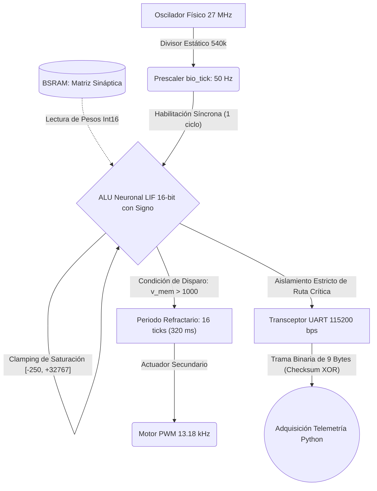

# Edge Neuromorphic LIF Accelerator on FPGA (Gowin GW1NR-9C)


## Resumen Ejecutivo
Implementación RTL de una arquitectura neuromórfica dirigida por eventos (*Spiking Neural Network*) evaluada sobre hardware FPGA Tang Nano 9K (Gowin GW1NR-9C). Resuelve la ineficiencia térmica y el cuello de botella de Von Neumann mediante computación *in-memory* a nivel de compuerta. La ecuación diferencial biológica de membrana se discretiza en silicio mediante aritmética de saturación de punto fijo con signo de 16 bits, prescindiendo por completo de bloques DSP y garantizando una correlación matemática exacta ($R=1.0000$) con modelos *golden* de neurociencia computacional.

---

## 📚 Documentación Científica y Guía de Ponencia

Para evaluadores del semillero, jurados y pares académicos, la investigación completa se encuentra estratificada en 5 documentos de soporte:

* 📄 **[Reporte Técnico & Paper Científico (`docs/TECHNICAL_REPORT.md`)](docs/TECHNICAL_REPORT.md):** Memoria de investigación formal, derivación analítica de Euler discreto, límites físicos de la plataforma y *roadmap* hacia redes multicapa con protocolo AER (*Address Event Representation*).
* 🎤 **[Guía de Ponencia & Speaker Guide (`docs/SPEAKER_GUIDE.md`)](docs/SPEAKER_GUIDE.md):** Guion de oratoria para defensa pública, gancho científico de 60 segundos, protocolo de demostración en vivo y defensa rigurosa de preguntas críticas de ingeniería (STA, SDC `set_false_path`, asfixia de I/O).
* 📋 **[Ficha Técnica de Silicio (`docs/FICHA_TECNICA.md`)](docs/FICHA_TECNICA.md):** Hoja de datos completa, mapa de pines físicos (CST/SDC), arquitectura del prescaler de 50 Hz, vúmetro PWM de 13.2 kHz y configuración de memoria no volátil *embFlash*.
* ⏱️ **[Guion de Demostración en Vivo (`docs/GUION_DEMO.md`)](docs/GUION_DEMO.md):** Protocolo cronometrado minuto a minuto para exhibición interactiva con pulsadores táctiles S1/S2 y telemetría serial en tiempo real.
* 🔍 **[Auditoría Forense de Silicio (`docs/GROUND_TRUTH_AUDIT.md`)](docs/GROUND_TRUTH_AUDIT.md):** Registro forense de equivalencia bit a bit entre la captura serial del puerto COM4 y la simulación RTL con Icarus Verilog.

---

## Arquitectura Interna del Silicio ("Inside the Black Box")

La interfaz visual (LEDs) opera exclusivamente como actuador esclavo PWM. El núcleo computacional es una máquina de estados finitos (FSM) síncrona gobernada por un *prescaler* a 50 Hz, que procesa tensores desde la memoria BSRAM y transmite el estado estricto del hardware a través de un bus UART dedicado.



---

## Formulación Matemática de Silicio (Euler Discreto 16-bit)

La ecuación diferencial continua de membrana, $\tau \frac{dV}{dt} = -(V - V_{rest}) + R \cdot I_{syn}$, se discretizó mediante el método de integración de Euler hacia adelante parametrizado a 50 Hz ($\Delta t = 20.0\text{ ms}$):

$$V[k+1] = V[k] - (V[k] \ggg 4) + I_{syn}[k]$$

* **Fuga Pasiva Asintótica:** Se ejecuta mediante un desplazamiento aritmético a la derecha con signo (`v_mem >>> 4`), eliminando la necesidad de multiplicadores DSP o FPUs. En cada tick, la neurona disipa el $6.25\%$ de su carga en 1 ciclo de reloj ($37.037\text{ ns}$).
* **Constante de Tiempo Biológica:** $\tau \approx 320\text{ ms}$ ($\alpha = 1 - 2^{-4} = 0.9375$).
* **Resolución por Bit:** Reposo ($0_{hw} \equiv -70.0\text{ mV}$), Umbral de disparo ($1000_{hw} \equiv -50.0\text{ mV}$), estableciendo un LSB rígido de $20.0\text{ }\mu\text{V/LSB}$.
* **Protección contra Wrap-Around:** Acumulador extendido de 18 bits con signo (`v_sum`) y clamping simétrico:
  $$\text{Techo Supraluminal: } +32,767_{hw} \quad\mid\quad \text{Piso de Hiperpolarización } (V_{MIN}): -250_{hw}\;(-75.0\text{ mV})$$

---

## Protocolo de Telemetría UART (Trama Binaria de 9 Bytes a 115200 bps)

Para garantizar la observabilidad del estado interno sin alterar la latencia computacional (Observer Effect), la FPGA emite de forma continua una trama estructurada de 9 bytes en cada pulso de `bio_tick` (50 Hz):

| Byte | Campo | Formato | Descripción |
| :---: | :--- | :---: | :--- |
| **0** | Sincronismo 1 | `0xAA` | Primer byte delimitador de inicio de trama |
| **1** | Sincronismo 2 | `0x55` | Segundo byte delimitador de inicio de trama |
| **2** | `v_mem[15:8]` | `int8` | Byte más significativo (MSB) del potencial de membrana |
| **3** | `v_mem[7:0]` | `uint8`| Byte menos significativo (LSB) del potencial de membrana |
| **4** | `i_syn[15:8]` | `int8` | Byte más significativo (MSB) de la corriente sináptica |
| **5** | `i_syn[7:0]` | `uint8`| Byte menos significativo (LSB) de la corriente sináptica |
| **6** | `spike` | `uint8`| Bandera de potencial de acción (`0x01` = disparo activo, `0x00` = inactivo) |
| **7** | `checksum` | `uint8`| Checksum XOR: `v_mem_H ^ v_mem_L ^ i_syn_H ^ i_syn_L ^ spike` |
| **8** | Fin de Trama | `0x0A` | Carácter terminador de fin de paquete (`\n`) |

---

## Inmersión Técnica Módulo por Módulo

* **`lif_neuron.v`:** Núcleo aritmético. Implementa la ecuación de Euler discreto en aritmética de 16 bits con signo (`16'sd`). Protegido mediante un sumador extendido de 18 bits que previene el desbordamiento circular (*wrap-around*), forzando el clamping estricto entre $+32767$ y $-250$.
* **`bram_synapse_matrix.v`:** Memoria de pesos sinápticos parametrizada (`ADDR_WIDTH=4`, `DATA_WIDTH=16`). Utiliza el pragma `(* ram_style = "block" *)` para forzar la síntesis en bloques BSRAM nativos, evitando el consumo ineficiente de lógica distribuida (LUTs) e implementando un reset síncrono para anular estados indeterminados (`'x'/'z'`).
* **`button_debouncer.v`:** Acondicionador físico industrial. Cadena de doble Flip-Flop (2-FF Synchronizer) contra metaestabilidad y filtro de rebote mecánico de 20 ms (540,000 ciclos a 27 MHz), garantizando un estímulo biológico determinista e inmunidad total a ruidos transitorios.
* **`uart_transceiver.v`:** Interfaz de transmisión serie síncrona a 115200 baudios. Serializa los registros de 16 bits sin introducir contrapresión (*back-pressure*) sobre la ALU neuronal.
* **`top_lif_demo.v`:** Módulo de integración *top-level*. Integra el sincronizador de reset determinista (AASD de 4 etapas), el generador de reloj biológico a 50 Hz, el vúmetro PWM analógico a 13.18 kHz para modulación suave en los LEDs y el serializador de telemetría de 9 bytes.

---

## Métricas Duras y Benchmarks de Silicio (GW1NR-9C)

| Métrica Paramétrica | Valor Extraído en Silicio | Implicación Arquitectónica |
| :--- | :---: | :--- |
| **LUTs (Lógica Combinacional)** | **833 / 8,640 (9.64%)** | Margen área-lógica habilitado para expansión de nodos de red |
| **Registros (Flip-Flops)** | **207 / 6,480 (3.19%)** | Carga capacitiva mínima en enrutamiento estático cruzado |
| **Memoria en Bloque (BSRAM)** | **1 / 26 Bloques (3.85%)** | Infraestructura disponible para plasticidad local (STDP) |
| **Temporizado Estático ($F_{clk}$)** | **27.0 MHz (Holgura: > 27 ns)** | Determinismo absoluto; 0 violaciones de Setup/Hold |
| **Validación Cruzada (RTL vs Python)** | **Pearson $R = 1.0000$, RMSE $= 0.0$** | Identidad bit a bit sobre 132 ciclos biológicos evaluados |

---

## Guía de Reproducción Determinista

Ejecución automatizada desatendida mediante toolchains de código abierto y CLI nativa:

```bash
# 1. Clonar repositorio e instalar dependencias del host
git clone https://github.com/Kxvinnnn/tang-nano-lif-verilog.git
cd tang-nano-lif-verilog
pip install -r requirements.txt

# 2. Simulación RTL (Requiere Icarus Verilog & VVP)
# 2.1 Verificación unitaria del núcleo LIF
iverilog -g2012 -s tb_lif_neuron -o build/sim_unit.vvp \
  src_verilog/hdl/lif_neuron.v \
  src_verilog/tb/tb_lif_neuron.v
vvp build/sim_unit.vvp

# 2.2 Verificación de integración del sistema completo con debouncers
iverilog -g2012 -s tb_top_system -o build/sim_top.vvp \
  src_verilog/hdl/button_debouncer.v \
  src_verilog/hdl/bram_synapse_matrix.v \
  src_verilog/hdl/lif_neuron.v \
  src_verilog/hdl/uart_transceiver.v \
  src_verilog/hdl/top_lif_demo.v \
  src_verilog/tb/tb_top_system.v
vvp build/sim_top.vvp

# 3. Validación Cruzada con el Modelo Matemático Golden
python src_py/lif_math_model.py

# 4. Emulación de Equivalencia en Punto Fijo (int16)
python src_py/lif_equivalence.py --steps 1000 --csv docs/lif_equivalence_data.csv --plot docs/lif_equivalence_plot.png

# 5. Síntesis y P&R con Gowin EDA CLI
gw_sh build.tcl

# 6. Programación en Flash Interna No Volátil
openFPGALoader -b tangnano9k -f impl/pnr/LIF_Hardware.fs

# 7. Adquisición de Telemetría en Vivo (Python)
python telemetry/telemetry_listener.py --port COM4 --baud 115200 --log-csv telemetry_data/captura_telemetria.csv
```

---

## Estructura Modular del Proyecto

```text
├── .github/workflows/              # Pipeline de Integración Continua (GitHub Actions)
│   └── rtl_validation.yml          # Verificación formal de aserciones RTL y tolerancia cero a 'X'
├── .gitignore                      # Reglas de exclusión para Gowin EDA, Python y temporales
├── README.md                       # Documentación maestra y abstract técnico (Capa 1)
├── requirements.txt                # Dependencias fijadas del host (pyserial, numpy, matplotlib)
├── LICENSE                         # Licencia de código abierto MIT (Kevin Mejía Cedeño)
├── Makefile                        # Automatización de compilación, simulación y programación
├── build.tcl                       # Script de automatización TCL para síntesis y P&R en Gowin
├── LIF_Hardware.gprj               # Archivo de proyecto maestro de Gowin EDA
│
├── constraints/                    # Restricciones físicas y temporales
│   ├── tangnano9k.sdc              # Restricción de temporizado estático (27 MHz)
│   └── tangnano9k.cst              # Asignación física de pines (Tang Nano 9K)
│
├── data/                           # Coeficientes estáticos y pesos cuantizados
│   ├── pesos_sinapticos.hex        # Matriz de pesos cuantizados para memoria BRAM (+68 / -65)
│   └── weights.hex                 # Tabla complementaria de pesos pre-entrenados
│
├── src_verilog/                    # [Arquitectura Hardware RTL y Testbenches]
│   ├── hdl/                        # Módulos sintetizables en silicio (Single Source of Truth)
│   │   ├── top_lif_demo.v          # Integración top-level, prescaler 50 Hz y PWM 13.2 kHz
│   │   ├── lif_neuron.v            # Núcleo aritmético LIF continuo con clamping (16-bit)
│   │   ├── bram_synapse_matrix.v   # Matriz de pesos BRAM con protección contra 'X'/'Z'
│   │   ├── button_debouncer.v      # Acondicionador 2-FF y antirrebote mecánico (20 ms)
│   │   ├── uart_transceiver.v      # Transmisor serial síncrono a 115200 bps
│   │   ├── aer_transmitter.sv      # Transmisor AER para escalado a eventos dispersos (Roadmap)
│   │   ├── csr_bram_ctrl.sv        # Controlador CSR para reconfiguración en caliente (Roadmap)
│   │   ├── lif_tdm_core.sv         # Núcleo multicelular por multiplexación temporal (Roadmap)
│   │   └── top_tdm_snn.sv          # Top-level multi-nodo escalable (Roadmap)
│   └── tb/                         # Bancos de pruebas de verificación
│       ├── tb_lif_neuron.v         # Testbench de verificación funcional unitaria (132 ticks)
│       └── tb_top_system.v         # Testbench de integración a nivel de sistema con ruido
│
├── src_py/                         # [Modelo Matemático Golden & Validación]
│   ├── lif_math_model.py           # Modelo analítico Golden bit a bit (Verificación cruzada)
│   ├── lif_equivalence.py          # Emulador de equivalencia ciclo a ciclo en punto fijo (int16)
│   └── train_and_export.py         # Generador y cuantizador de pesos sinápticos BRAM
│
├── telemetry/                      # [Scripts de Adquisición UART e Inferencia]
│   └── telemetry_listener.py       # Receptor multihilo de tramas de 9 bytes a 115200 bps
│
├── telemetry_data/                 # Buffer de almacenamiento para capturas seriales en vivo (.csv)
│   └── .gitkeep                    # Retención de directorio en control de versiones
│
└── docs/                           # [Reportes de Investigación y Benchmarks]
    ├── GROUND_TRUTH_AUDIT.md       # Auditoría forense y verdad base del silicio
    ├── TECHNICAL_REPORT.md         # Memoria de investigación y roadmap AER (Capa 2)
    ├── SPEAKER_GUIDE.md            # Guion de ponencia e instrucción operativa (Capa 3)
    ├── FICHA_TECNICA.md            # Hoja de datos técnicos de hardware y pinout físico
    ├── GUION_DEMO.md               # Guion cronometrado minuto a minuto
    ├── lif_validation_curve.png    # Curva de correlación temporal Golden vs RTL
    ├── lif_equivalence_plot.png    # Gráfica científica de 3 paneles (1000 pasos / 20 s)
    └── lif_equivalence_data.csv    # Dataset tabular generado por la emulación de 16 bits
```

---

## Licencia
Este proyecto está licenciado bajo los términos de la [Licencia MIT](LICENSE) - Copyright (c) 2026 Kevin Mejía Cedeño.
